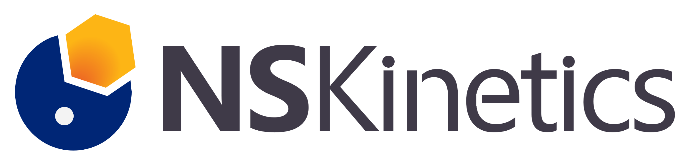
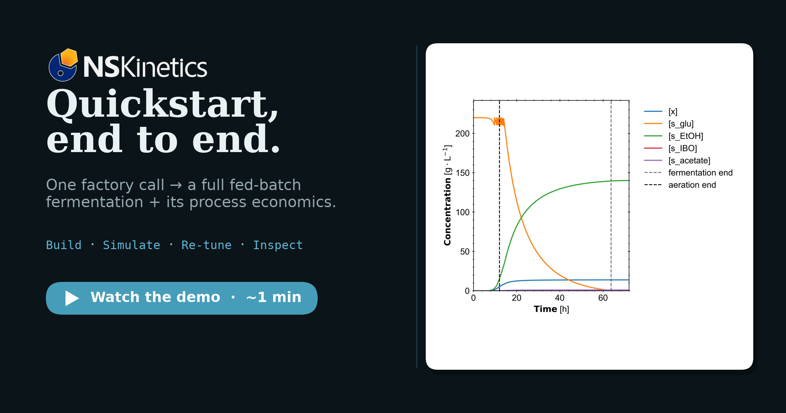

===============================================================
The (Non-)Steady state Kinetics simulation package (NSKinetics)
===============================================================

.. image:: http://img.shields.io/pypi/v/nskinetics.svg?style=flat
   :target: https://pypi.python.org/pypi/nskinetics
   :alt: Version_status
.. image:: http://img.shields.io/badge/docs-latest-brightgreen.svg?style=flat
   :target: https://nskinetics.readthedocs.io/en/latest/
   :alt: Documentation
.. image:: http://img.shields.io/badge/license-MIT-blue.svg?style=flat
   :target: https://github.com/sarangbhagwat/nskinetics/blob/main/LICENSE
   :alt: license
.. image:: https://img.shields.io/pypi/pyversions/nskinetics.svg
   :target: https://pypi.python.org/pypi/nskinetics
   :alt: Supported_versions
.. image:: https://coveralls.io/repos/github/sarangbhagwat/nskinetics/badge.svg?cachebuster=202507072
   :target: https://coveralls.io/github/sarangbhagwat/nskinetics?branch=main

**Contents**

.. contents::
   :local:

What is NSKinetics?
-------------------

NSKinetics is a fast, flexible, and convenient package in Python for simulating steady- and non-steady-state reaction kinetics — including microbial fermentation and enzyme kinetics — and connecting them to techno-economic analysis (TEA) and life-cycle assessment (LCA) under uncertainty. Kinetic models are declared as SBML — most easily authored as `Antimony <https://tellurium.readthedocs.io/en/latest/antimony.html>`__ text, or imported from an existing SBML file — and wrapped in a ``KineticModel``, which adds unit-aware value access and a Python event API on top of a Tellurium RoadRunner engine that performs the actual ODE integration. ``Event`` covers a single trigger/assignment pair (a parameter switch, a control action); the higher-level ``FeedSpike`` builds on it for fed-batch feeding, topping a species back up to a target concentration whenever it drops below a threshold. The same kinetic model can then drive a `BioSTEAM <https://biosteam.readthedocs.io/en/latest/>`__ process unit through the ``NSKBatchReactor`` bridge, coupling kinetics directly to TEA.

Installation
------------

Get the latest version of NSKinetics from `PyPI <https://pypi.org/project/nskinetics/>`__. If you have an installation of Python with pip, simply install it with:

.. code-block:: bash

    $ pip install nskinetics

To get the git version, run:

.. code-block:: bash

    $ git clone https://github.com/sarangbhagwat/nskinetics

For help on common installation issues, please visit the `documentation <https://nskinetics.readthedocs.io/en/latest/>`__.

Documentation
-------------

NSKinetic's `full documentation <https://nskinetics.readthedocs.io/en/latest/>`__ includes a staged tutorial, starting from a minimal model and building up to a full process/TEA-coupled fed-batch fermentation. The interactive quickstart demo below runs that full picture end to end.

One factory call builds a complete, industrially configured process around a real kinetic model: ``nskinetics.processes.create_sugar_prep_and_fermentation_system`` assembles the sugar-solution preparation and fed-batch fermentation section of an actual biorefinery model — a splitter feeding parallel initial-feed and spike-feed conditioning trains (multi-effect evaporator, pumps, dilution-water mixer, heat exchanger), a ``FermentationSaccharomycesEthanolIsobutanol`` fermentor driven by the shipped *S. cerevisiae* kinetic model, and a compressed-air aeration loop. The complete biorefinery built around this section ships with NSKinetics as the `isobutanol biorefinery case study <https://nskinetics.readthedocs.io/en/latest/case_studies/isobutanol/index.html>`__. This example runs the section end to end: build, simulate, change the fed-batch strategy, and inspect the reactor. Total simulation time is a few seconds once the imports are loaded; the ~1-minute interactive demo below plays through the whole thing, showing real output at every step:

   ▶ `Watch the quickstart run end to end <https://nskinetics.readthedocs.io/en/latest/_static/quickstart_demo.html>`__ — a ~1-minute interactive demo (build, simulate, re-tune, inspect).

See the `full tutorial <https://nskinetics.readthedocs.io/en/latest/tutorial/index.html>`__ for the full walkthrough — writing and simulating a kinetic model from scratch, the ``Event``/``FeedSpike`` API used inside the fermentor, a tour of the shipped *S. cerevisiae* kinetic model, the kinetics-to-biosteam bridge behind ``V406``, and the sensitivity, identifiability and calibration tools below.

Reproducible runs, sensitivity and calibration
----------------------------------------------

NSKinetics also answers the questions asked of a kinetic model before it is trusted — which parameters matter, which ones measurements can determine, and which values the data support — with every run reproducible and every analysis aware of the events that drive fed-batch operation. Analyses work on a private copy of the model and never change yours.

* **Reproducible runs and batch scans.** A ``Condition`` describes one run (initial values, temporary parameter values, output times); ``KineticModel.run`` runs it from the model's baseline and returns a ``SimulationResult``. ``run_many`` and ``scan`` run many conditions, or a grid of parameter and initial values, serially or on a process pool, and record failed runs instead of raising; ``KineticModel.copy`` gives an independent model.
* **Sensitivity, identifiability and global screening** (``nskinetics.analysis``). ``local_sensitivity`` differentiates time courses and metrics such as titer, yield and productivity across feed events, and flags the derivatives an event makes unreliable; ``identifiability`` tells which parameters given measurements can determine, and which combinations they cannot; ``morris`` and ``sobol`` screen parameters over ranges.
* **Fed-batch-aware calibration with uncertainty.** ``fit_parameters`` fits rate constants, initial values (shared or per experiment) and observable scales to several fed-batch runs, each with its own feeding recipe, from reproducible multistarts or after a global search. The result reports standard errors, 95% intervals, correlations and warnings; ``profile_likelihood`` gives profile-likelihood intervals, and ``FitResult.predict`` prediction bands.

These tools need NSKinetics 0.7.0 or later. Until 0.7.0 is on PyPI, install it from source: clone this repository, then run ``pip install -e .`` in it.

A tiny example — build a model, ask what hourly measurements could determine, and fit it to synthetic data (a few seconds once NSKinetics is imported):

.. code-block:: python

    import numpy as np
    import pandas as pd
    import nskinetics as nsk
    from nskinetics.analysis import (local_sensitivity, identifiability, Dataset,
                                     Observable, Experiment, FitParameter,
                                     CalibrationProblem, fit_parameters)

    # S -> P; a feed adds 18 g/L of S whenever S drops below 2 g/L, twice at most
    km = nsk.KineticModel.from_antimony("""
    model toy()
      species S = 20, P = 0;
      kcat = 2; E = 1; Km = 5; n = 0;
      J: S => P; kcat*E*S/(Km + S);
      feed: at (S < 2 && n < 2): S = S + 18, n = n + 1;
    end
    """, units={'time': 'h', 'conc': 'g/L'})

    # A run: 48 h with hourly outputs, always started from the model's baseline
    cond = nsk.Condition(t_end=48, n_steps=49)

    # Which parameters could hourly S and P data (SD 0.2 g/L) determine?
    ls = local_sensitivity(km, cond, ['kcat', 'E', 'Km'], outputs=['[S]', '[P]'])
    ident = identifiability(ls, sigma={'[S]': 0.2, '[P]': 0.2})
    print(ident.table['identifiable'].to_dict())

    # Synthetic data from a "true" run (kcat = 2.5, Km = 8); fit kcat and Km
    truth = km.run(cond.with_parameters(kcat=2.5, Km=8))
    noise = np.random.default_rng(0).normal(0, 0.2, (2, 49))
    wide = pd.DataFrame({'run': 'A', 'time': truth.time,
                         'S': truth['[S]'] + noise[0],
                         'P': truth['[P]'] + noise[1]})
    data = Dataset.from_wide(wide, experiment='run', time='time',
                             columns=['S', 'P'])
    problem = CalibrationProblem(
        km, [Experiment('A', cond, data)],
        [Observable('S', '[S]', sigma=0.2), Observable('P', '[P]', sigma=0.2)],
        [FitParameter('kcat', bounds=(0.1, 10)),
         FitParameter('Km', bounds=(0.5, 50))])
    fit = fit_parameters(problem, seed=0)
    print(fit.estimates.round(2).to_dict())

prints:

.. code-block:: text

    {'kcat': False, 'E': False, 'Km': True}
    {'kcat': 2.48, 'Km': 7.85}

``kcat`` and ``E`` act only through their product, so no measurement of ``S`` and ``P`` can tell them apart, while ``Km`` can be determined. With ``E`` fixed, the fit recovers ``kcat`` and ``Km`` (truth: 2.5 and 8), and ``fit.summary()`` lists any warnings first (such as ``lack_of_fit``, a fit that misses the data), then their standard errors and 95% intervals. The tutorials cover each step: `building and simulating a model <https://nskinetics.readthedocs.io/en/latest/tutorial/02_build_and_simulate.html>`__, `sensitivity and identifiability <https://nskinetics.readthedocs.io/en/latest/tutorial/07_sensitivity_identifiability.html>`__, and `calibration <https://nskinetics.readthedocs.io/en/latest/tutorial/08_calibration.html>`__.

Since 0.7.0, ``KineticModel.reset()`` of a model without a custom ``reset_func`` restores a true baseline — volumes, feed counters and other event-assigned variables included — so repeated runs of an event-driven model no longer start from where the previous run ended (see the `changelog <https://nskinetics.readthedocs.io/en/latest/changelog.html>`__).

Case study: isobutanol biorefinery
----------------------------------

NSKinetics ships a complete corn dry-grind biorefinery as a case study, ``nskinetics.biorefineries.isobutanol``: a `BioSTEAM <https://biosteam.readthedocs.io/en/latest/>`__ flowsheet whose fermentor runs the shipped *S. cerevisiae* fed-batch model with an engineered isobutanol pathway, so titer, rate and yield are outputs of the strain kinetics and the feeding policy rather than inputs to the techno-economic analysis. It comes with ten scenarios (the wild-type ethanol plant, an engineered ethanol + isobutanol co-producer and eight strain-design optima), its TEA, and the scripts behind its feeding-strategy and kinetic sweeps, Bayesian strain-design optimization, objective-landscape, enzyme-burden (proteome allocation), global sensitivity and uncertainty analyses.

The case study needs NSKinetics 0.7.0 or later, the first release that ships ``nskinetics.biorefineries``; earlier releases do not include it. Until 0.7.0 is on PyPI, install it from source, with its optional ``isobutanol`` dependencies, and check the installation with a pinned smoke case (a few minutes):

.. code-block:: bash

    $ git clone https://github.com/sarangbhagwat/nskinetics
    $ cd nskinetics
    $ git checkout dev
    $ pip install -e ".[isobutanol]"
    $ python -m nskinetics.biorefineries.isobutanol.smoke 1

Once 0.7.0 is on PyPI, ``pip install "nskinetics[isobutanol]>=0.7.0"`` installs the same package and dependencies. `Running the analyses <https://nskinetics.readthedocs.io/en/latest/case_studies/isobutanol/running_analyses.html>`__ has the full installation instructions (including the validated dependency versions) and lists every analysis script, its runtime and its outputs; the `case study documentation <https://nskinetics.readthedocs.io/en/latest/case_studies/isobutanol/index.html>`__ presents the findings.

Bug reports
-----------

To report bugs, please use NSKinetics's Bug Tracker at:

    https://github.com/sarangbhagwat/nskinetics

Contributing
------------
For guidelines on how to contribute, visit:

    [link to be added]

License information
-------------------

See ``LICENSE.txt`` for information on the terms & conditions for usage
of this software, and a DISCLAIMER OF ALL WARRANTIES.

Although not required by the NSKinetics license, if it is convenient for you,
please cite NSKinetics if used in your work. Please also consider contributing
any changes you make back, and benefit the community.

About the authors
-----------------

NSKinetics was created and developed by `Sarang S. Bhagwat <https://github.com/sarangbhagwat>`__ as part of the `Scown Group <https://cscown.com/>`__ and the `Energy & Biosciences Institute <https://energybiosciencesinstitute.org/>`__ at the `University of California, Berkeley (UC Berkeley) <https://www.berkeley.edu/>`__. 

References
----------
.. [1] ` To be added <link to be added>`__.

